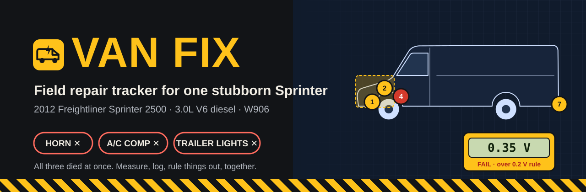
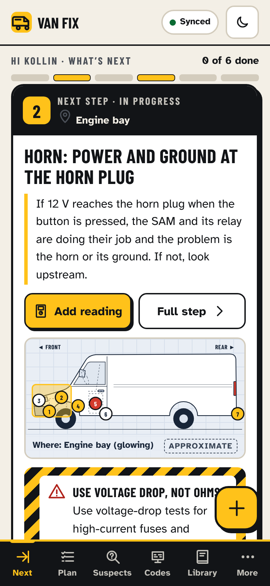
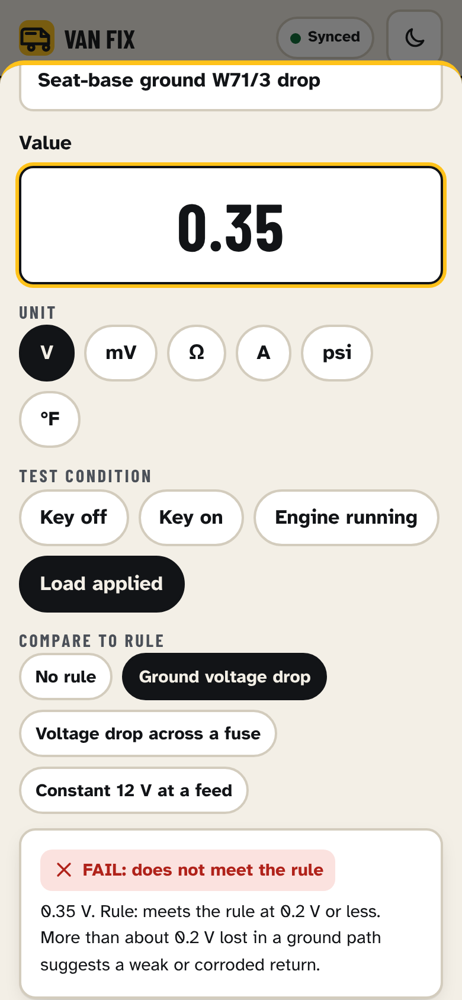
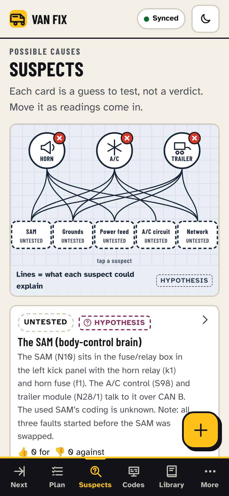
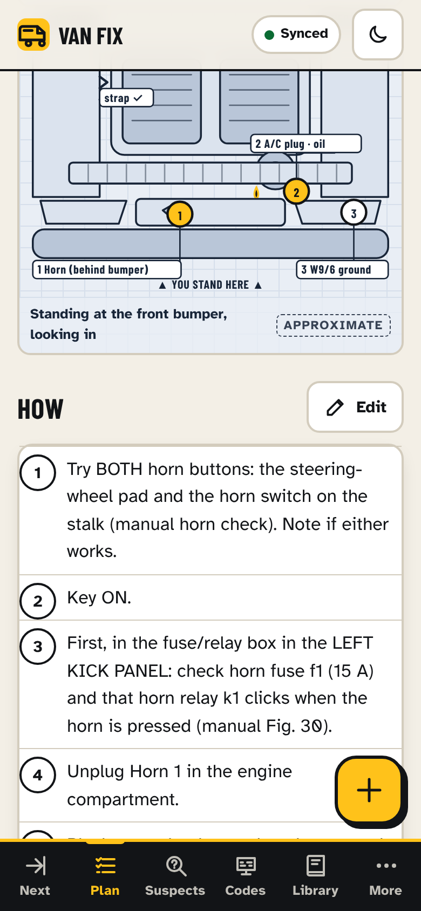
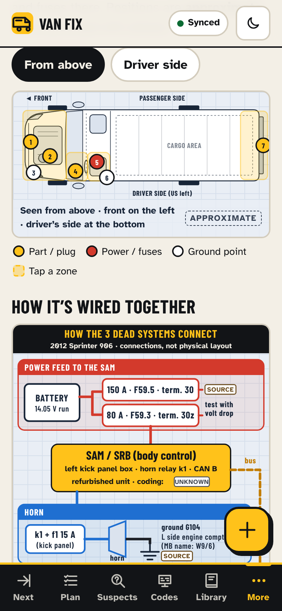
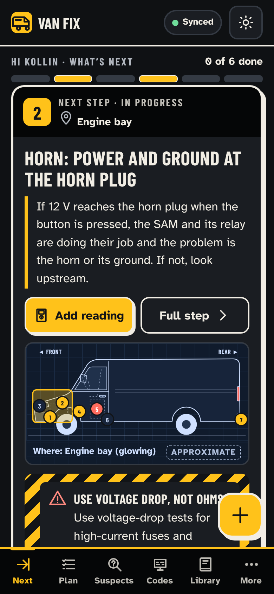
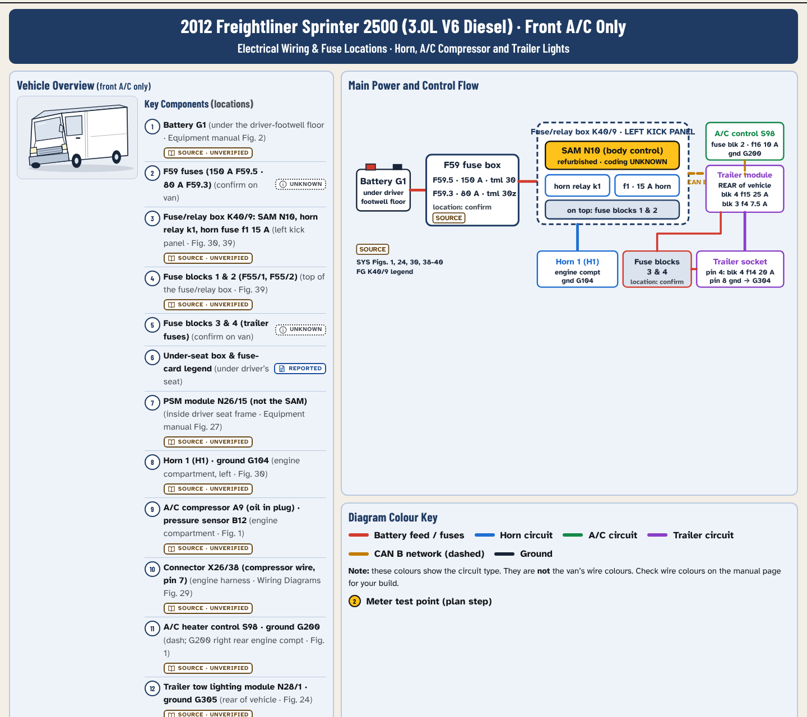
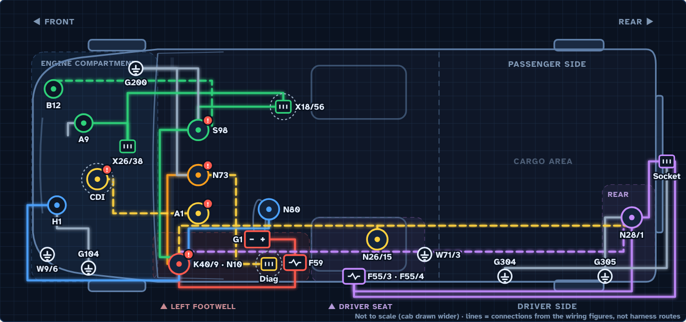
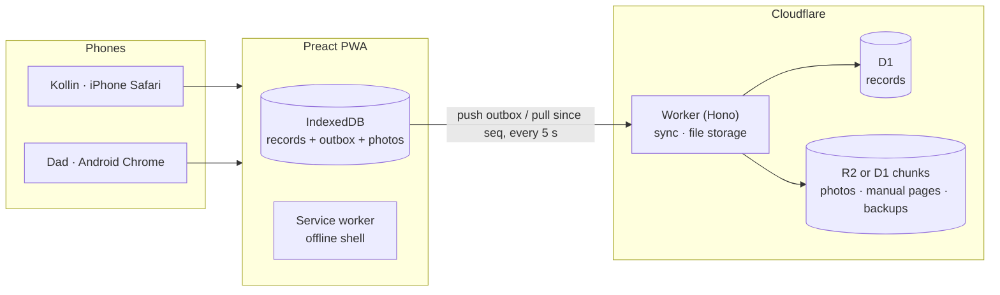

<p align="center">
  
</p>

<p align="center">
  
  
  
  
  
  
</p>

<p align="center"><b>Two phones. One van. No guessing.</b><br>
An installable web app that Kollin (iPhone) and his dad (Android) use side by side in the driveway to track down why a 2012 Freightliner Sprinter's <b>horn, A/C compressor and trailer lights</b> all stopped at the same time.</p>

---

## Why this exists

Three unrelated-looking systems failed together, *before* the SAM body-control module was swapped. That points at something they share: the SAM, its big feed fuses, the CAN B network or shared grounds. Chasing that across chat threads, PDFs and memory wasn't working. Van Fix puts the plan, the measurements, the suspects and the wiring references in one place that both phones see live, even with no signal.

<table>
<tr>
<td width="33%" align="center"><br><b>What's next</b><br><sub>One step at a time, with where on the van it happens.</sub></td>
<td width="33%" align="center"><br><b>Readings with a rule</b><br><sub>Big number pad. PASS / FAIL / CHECK with the rule spelled out.</sub></td>
<td width="33%" align="center"><br><b>Suspects board</b><br><sub>Every cause is a hypothesis until a measurement says otherwise.</sub></td>
</tr>
<tr>
<td align="center"><br><b>Steps from the manuals</b><br><sub>Fuse f1, relay k1, ground G104, each with its figure number.</sub></td>
<td align="center"><br><b>Where things are</b><br><sub>Tap a zone. Photos you mark turn "approximate" into "confirmed".</sub></td>
<td align="center"><br><b>Sunlight and night</b><br><sub>High-contrast light theme, true dark mode, 48 px touch targets.</sub></td>
</tr>
</table>

### The wiring sheet

Everything on one page: component locations, power and control flow, fuse tables, and the horn, A/C and trailer circuits, redrawn from the owner's Mercedes 906 manuals. Each value cites its figure.

<p align="center"></p>

The sheet also has an **ignition feed** panel (EIS N73 → SAM → relays k8 / k6 → f18, f11, f13, from Figs. 39-40) and a **CAN network** panel that overlays the scan's "no CAN message from…" codes on the module map.

### See-through wiring

An x-ray of the van from above. 24 parts (modules, fuse boxes, plugs and grounds) each sit in the area a source names, with seven circuit layers you can switch on and off: battery power, ignition, horn, A/C, trailer, CAN and grounds. Tap a part to see where it is, what it does, what it connects to and which figure says so. Red badges mark modules with scan codes. Lines are connections from the wiring figures, not harness routes, and the cab is drawn wider than life so the parts fit.

<p align="center"></p>

## What it does

| | |
|---|---|
| **Test plan** | Six ordered steps (photos, horn, big SAM fuses, trailer, read-only scan, A/C wire), each with why it matters, how to do it, safety banners and meter hook-up diagrams. |
| **Readings** | Value, unit (V, mV, Ω, A, psi, °F) and test condition in a few taps. Compared against editable rules such as "ground drop ≤ 0.2 V". The wording is always *meets / does not meet the rule*, never *the part is bad*. |
| **Suspects** | SAM, shared grounds, SAM power feed, A/C circuit and CAN network, each with evidence for and against and "what would change my mind". |
| **Fault codes** | The 2026-10-09 TOPDON scan, editable, with a "write it down before you clear it" guard. |
| **Library** | 51 manual pages (horn, trailer, A/C, power distribution, grounds, fuse box, battery, connectors) with pinch-zoom on both iOS and Android. Off on the open app (third-party manuals); turn on with `SERVE_MANUALS=1` for a private deployment. |
| **See-through wiring** | Top-down x-ray of the van with switchable circuit layers and a detail card for every part. |
| **Photos with markers** | Photograph an area, tap where each part is, and the location becomes CONFIRMED everywhere it's shown. |
| **Timeline** | Who measured what and when, filterable by person or type. |
| **Copy summary** | Plain-text summary with every label, ready to paste to Claude or a mechanic. Printable for a shop visit. |

### Provenance on everything

Nothing is presented as fact unless it was measured on this van.

| Label | Means |
|---|---|
|  | Measured or verified on this van |
|  | Told by someone, or read from a scan report |
|  | A possible explanation to test |
|  | From a manual, not yet checked on this VIN |
|  | Needed but not known yet |

## How it works



- **Offline-first.** Every write lands on the phone first, then syncs. Client-made IDs and last-write-wins mean retries never duplicate anything.
- **One table for everything.** Each step, reading, suspect and photo is a row in `records`. Sequence numbers are assigned inside the same D1 transaction, so a phone never misses an update.
- **No accounts.** Open the link, type your name once on each phone, and start. Writes are rate-limited per connection.
- **Not indexed, manuals not published.** Every response sends `noindex`, `robots.txt` blocks everything, and manual page images are only served when `SERVE_MANUALS=1` is set.
- **Storage that adapts.** Files go to R2 when a bucket is bound, otherwise into D1 in 1 MB chunks. Photos are shrunk to 1600 px on the phone before upload.

## Run it

```bash
npm install
npm run build && npm run dev:worker   # http://127.0.0.1:8787
```

| Command | What it does |
|---|---|
| `npm run dev` | Vite dev server (proxies `/api` to the worker) |
| `npm test` | Unit tests: rule engine, seed content, summary |
| `node tests/e2e.mjs` | Two-phone acceptance run against `wrangler dev` |
| `npm run build:artifact` | Single-file, device-only demo build |
| `./scripts/deploy.sh` | Production deploy (needs `CLOUDFLARE_API_TOKEN`) |

### Deploy

- **Your account:** `npx wrangler login && ./scripts/deploy.sh`. This builds, migrates D1 and deploys.
- **No login:** `npx wrangler deploy --temporary -c wrangler.temporary.toml` gives a live URL plus a claim link valid for 60 minutes.
- **Manual pages:** put the PDFs in `reference-source/` (git-ignored) and run `scripts/load-manual-pages.sh --remote`. Add `STORAGE=d1` when there's no R2 bucket.

## Project layout

```
shared/     types, seed content from the manuals, rule engine, summary builder
worker/     Cloudflare Worker: auth, sync, file storage, nightly backup
src/        Preact app
  illus/    every drawing: van views, zone scenes, meter hook-ups, circuits, wiring sheet
  screens/  Next, Plan, Suspects, Codes, Library, More, Wiring sheet
  lib/      IndexedDB store, sync loop, photos, router, theme
migrations/ D1 schema
scripts/    deploy, seed SQL, PDF → page images, icons
tests/      unit + two-phone end-to-end acceptance tests
```

## Safety first

> [!WARNING]
> Never put battery voltage on the A/C compressor plug until the compressor type and pins are confirmed. Write every code down before clearing anything. Verify power, grounds, fuses and relay control before replacing a module. Use voltage-drop tests, not ohms, on big fuses and grounds.

## A note on the manuals

The wiring and fuse references come from third-party Sprinter 906 workshop manuals the owner already has. They are **not** in this repository, and the open app does not serve them. The F59 and seat-base fuse box locations come from Mercedes' public 2015 Sprinter fuse allocation supplement and are labelled that way. Drawings in the app are tagged *approximate* or *concept* unless they cite a manual figure, and nothing invents fuse numbers, pinouts or wire colours.

<p align="center"><sub>Built for one van and two people. See <a href="CLAUDE.md">CLAUDE.md</a> for the data model and the hard rules.</sub></p>
